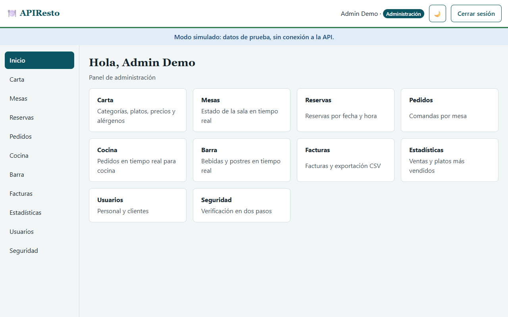
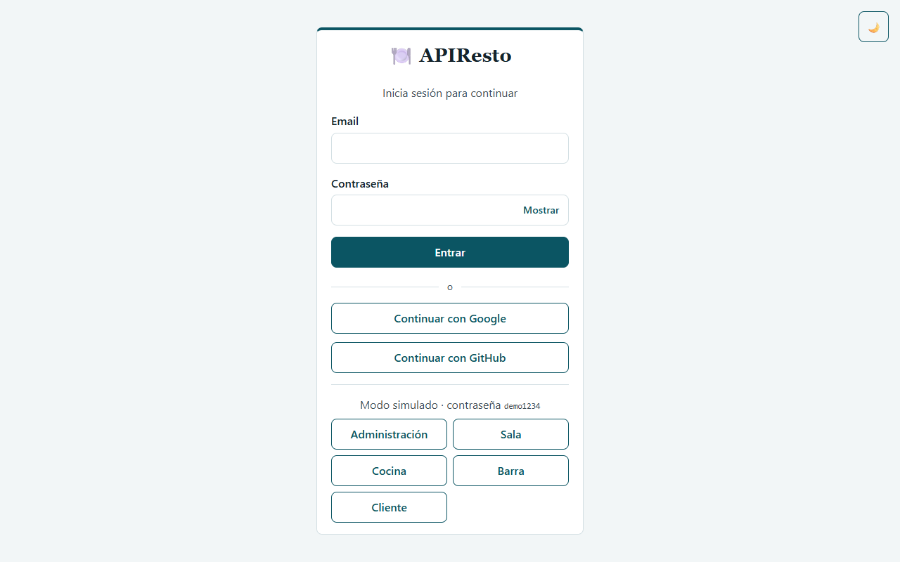
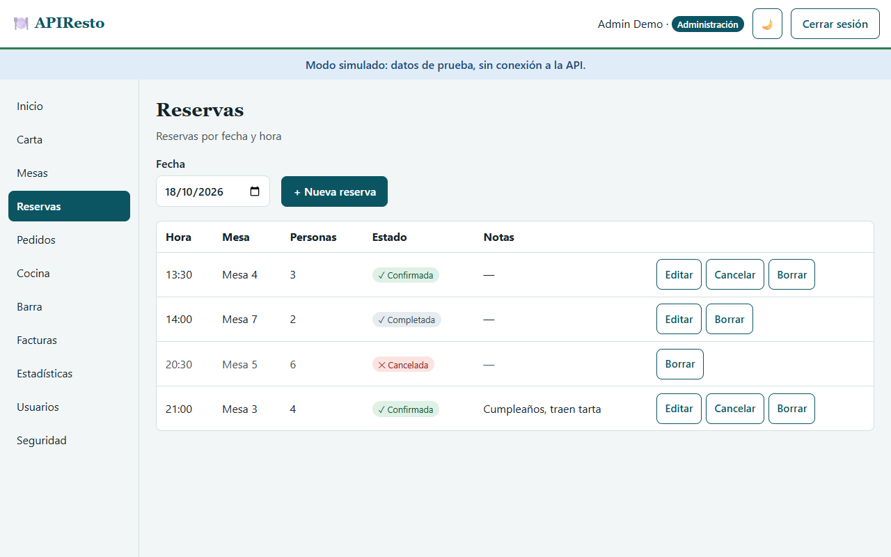
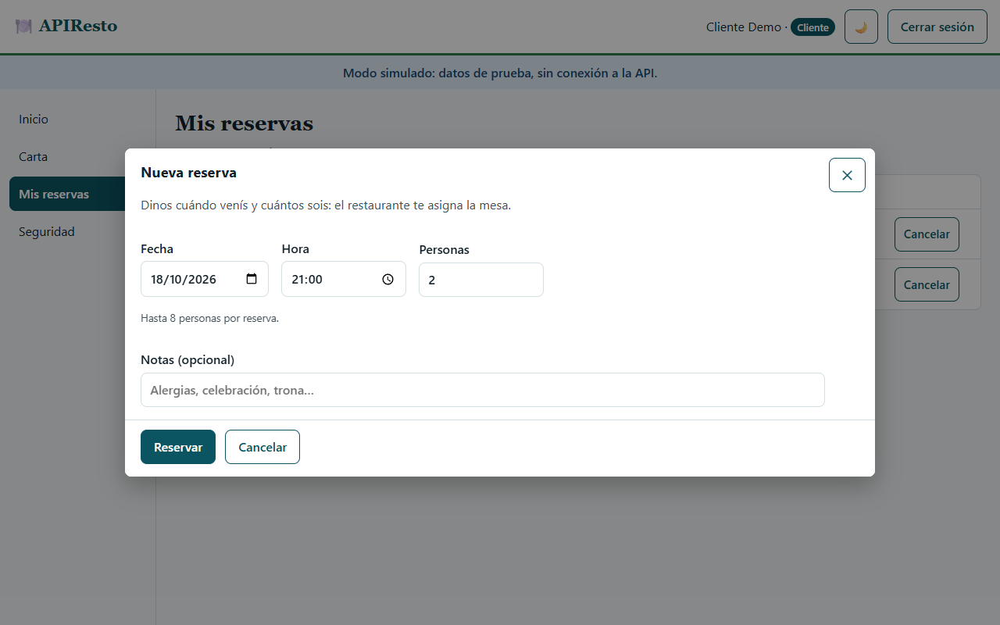
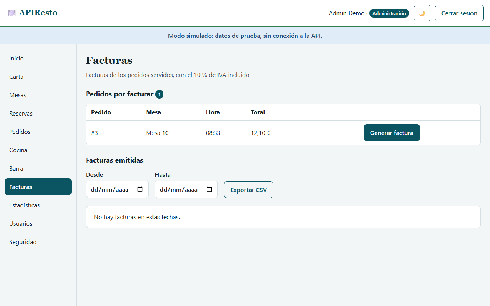
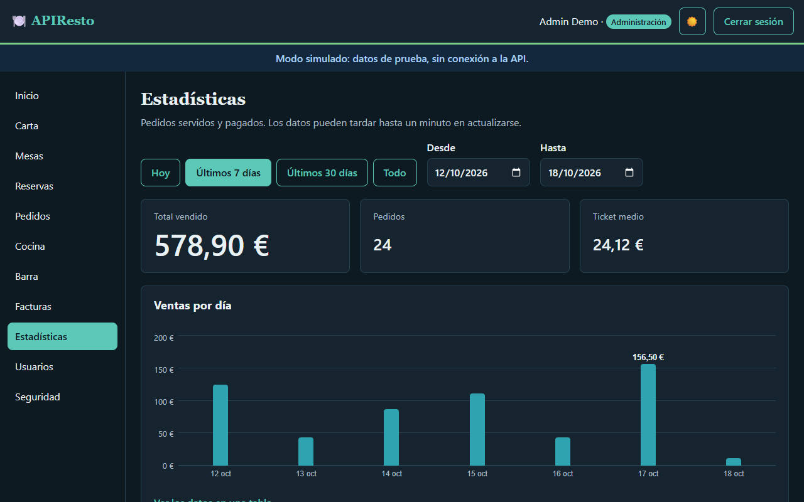
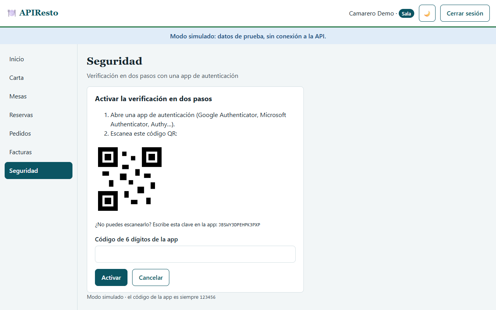

# 🍽️ APIResto

**Gestión de un restaurante en una sola web: carta, mesas, reservas, pedidos, cocina, barra, facturas y estadísticas, con una vista para cada rol.**

*Restaurant management in a single web app: menu, tables, bookings, orders, kitchen, bar, invoices and sales stats, with a view for each role.*

**[🇪🇸 Castellano](#castellano) · [🇬🇧 English](#english) · [📸 Capturas / Screenshots](#capturas--screenshots) · [🛠️ Documentación técnica / Technical docs](#documentación-técnica--technical-docs)**

> 🌐 **App:** [apiresto-f5.vercel.app](https://apiresto-f5.vercel.app) · **API:** [restoapi-47sp.onrender.com](https://restoapi-47sp.onrender.com) ([Swagger](https://restoapi-47sp.onrender.com/docs)) · **Frontend:** [IA-P1-BCN/APIResto_Frontend](https://github.com/IA-P1-BCN/APIResto_Frontend) · **Backend:** [IA-P1-BCN/APIResto_Backend](https://github.com/IA-P1-BCN/APIResto_Backend)



## Castellano

### Qué es

APIResto es un proyecto del bootcamp de IA de Factoría F5 (Barcelona): una API REST con FastAPI y PostgreSQL y una web en React que la usa. Cada persona del restaurante entra con su rol y ve solo lo que necesita: la sala toma los pedidos, la cocina y la barra los ven llegar al momento, la administración factura y consulta las ventas, y los clientes reservan mesa.

Este repositorio es la **web** (React). La API está en [IA-P1-BCN/APIResto_Backend](https://github.com/IA-P1-BCN/APIResto_Backend).

> La API está en el plan gratuito de Render y se duerme cuando nadie la usa: la primera petición puede tardar un minuto en despertarla.

### Equipo

| Rol | Persona | GitHub |
|---|---|---|
| Scrum Master | Rita Pereira | [@arita-pereira](https://github.com/arita-pereira) |
| Product Owner | Levi | [@levifvy](https://github.com/levifvy) |
| Desarrollo | Carla | [@cdecaprio](https://github.com/cdecaprio) |
| Desarrollo | Anna Costa | [@costanna](https://github.com/costanna) |
| Desarrollo | Manon | [@ManonChab](https://github.com/ManonChab) |

### Qué puede hacer cada rol

| Rol | En la web |
|---|---|
| **Administración** | Todo lo de la sala, la cocina y la barra; gestionar la carta y las mesas; facturas y exportación CSV; estadísticas de ventas |
| **Sala** (camarero) | Mesas en tiempo real, reservas, pedidos por mesa (enviar a cocina, servir por unidades, cobrar) y facturas |
| **Cocina** | Pedidos de cocina en directo: empezar, marcar unidades preparadas y servir |
| **Barra** | Lo mismo para bebidas y postres |
| **Cliente** | Ver la carta y reservar mesa (el restaurante le asigna la mesa; hasta 8 personas) |

Para todos: login con email y contraseña o con Google y GitHub, verificación en dos pasos (TOTP) opcional, límite de intentos de login, modo claro y oscuro y uso desde el móvil. El personal invitado crea su contraseña desde un enlace por email. La gestión de usuarios se hace desde la API (Swagger); en la web, la página *Usuarios* aún está en preparación.

### Probar la demo

1. Abre [apiresto-f5.vercel.app](https://apiresto-f5.vercel.app) y pulsa **Probar la demo**.
2. Elige un rol (Administración, Sala, Cocina, Barra o Cliente); la contraseña es `demo1234`.
3. La demo funciona entera en tu navegador, con datos de prueba: no toca la base de datos real. Tus cambios se guardan en ese navegador; *Empezar de cero* los borra.
4. En *Seguridad*, el código de la app de autenticación de la demo es siempre `123456`.

### Arquitectura

| Parte | Tecnología | Dónde |
|---|---|---|
| Web | React 19 + TypeScript + Vite | Vercel |
| API | FastAPI + SQLAlchemy + Alembic (Python 3.12) | Render |
| Base de datos | PostgreSQL | Neon |
| Tiempo real | WebSocket (`/ws/kitchen`) | Render |
| Emails | Brevo | — |

## English

### What it is

APIResto is a project from the Factoría F5 AI bootcamp (Barcelona): a REST API built with FastAPI and PostgreSQL, and a React web app that uses it. Each person in the restaurant signs in with their role and only sees what they need: floor staff take orders, the kitchen and the bar see them arrive instantly, admins invoice and check sales, and customers book a table.

This repository is the **web app** (React). The API lives in [IA-P1-BCN/APIResto_Backend](https://github.com/IA-P1-BCN/APIResto_Backend).

> The API runs on Render's free plan and sleeps when nobody uses it: the first request can take about a minute to wake it up.

### Team

| Role | Person | GitHub |
|---|---|---|
| Scrum Master | Rita Pereira | [@arita-pereira](https://github.com/arita-pereira) |
| Product Owner | Levi | [@levifvy](https://github.com/levifvy) |
| Developer | Carla | [@cdecaprio](https://github.com/cdecaprio) |
| Developer | Anna Costa | [@costanna](https://github.com/costanna) |
| Developer | Manon | [@ManonChab](https://github.com/ManonChab) |

### What each role can do

| Role | In the web app |
|---|---|
| **Admin** (*Administración*) | Everything the floor, kitchen and bar can do; manage the menu and the tables; invoices and CSV export; sales stats |
| **Floor staff** (*Sala*) | Live table status, bookings, orders per table (send to the kitchen, serve item by item, charge) and invoices |
| **Kitchen** (*Cocina*) | Live kitchen orders: start, mark units as prepared and serve |
| **Bar** (*Barra*) | The same for drinks and desserts |
| **Customer** (*Cliente*) | Browse the menu and book a table (the restaurant assigns the table; up to 8 people) |

For everyone: sign-in with email and password or with Google and GitHub, optional two-step verification (TOTP), a limit on failed sign-in attempts, light and dark mode, and mobile use. Invited staff set their own password from an email link. User management is done through the API (Swagger); in the web app, the *Usuarios* page is still in progress.

### Try the demo

1. Open [apiresto-f5.vercel.app](https://apiresto-f5.vercel.app) and click **Probar la demo**.
2. Pick a role (Administración, Sala, Cocina, Barra or Cliente); the password is `demo1234`.
3. The demo runs entirely in your browser with sample data and never touches the real database. Your changes are kept in that browser; *Empezar de cero* resets them.
4. Under *Seguridad*, the authenticator code in the demo is always `123456`.

### Architecture

| Part | Technology | Hosted on |
|---|---|---|
| Web app | React 19 + TypeScript + Vite | Vercel |
| API | FastAPI + SQLAlchemy + Alembic (Python 3.12) | Render |
| Database | PostgreSQL | Neon |
| Real time | WebSocket (`/ws/kitchen`) | Render |
| Email | Brevo | — |

## Capturas / Screenshots

Capturas de la demo, con datos de prueba; la interfaz está en castellano. · *Taken from the demo with sample data; the interface is in Spanish.*

| | |
|---|---|
|  **Login** con email, Google o GitHub, y la demo · *Sign-in with email, Google or GitHub, plus the demo* |  **Carta** con precios y alérgenos · *Menu with prices and allergens* |
|  **Mesas** en tiempo real · *Live table status* |  **Reservas** por fecha y hora · *Bookings by date and time* |
|  **Reserva del cliente**, sin elegir mesa · *Customer booking, no table to pick* |  **Pedidos** por mesa · *Orders per table* |
|  **Cocina** en directo · *Live kitchen screen* |  **Barra**: bebidas y postres · *Bar: drinks and desserts* |
|  **Facturas** y exportación CSV · *Invoices and CSV export* |  **Estadísticas** de ventas · *Sales stats* |
|  **Modo oscuro** · *Dark mode* |  **Verificación en dos pasos** (QR simulado en la demo) · *Two-step verification (simulated QR in the demo)* |

<p align="center"><br><b>En el móvil</b> · <i>On a phone</i></p>

---

## Documentación técnica / Technical docs

Lo que sigue es la documentación técnica de la web, en castellano. · *What follows is the web app's technical documentation, in Spanish.*

Despliegue: [guía de deploy](https://github.com/IA-P1-BCN/APIResto_Backend/blob/dev/docs/deploy.md) (solo Anna despliega).

## Stack

| Capa | Tecnología |
|---|---|
| UI | React 19 + TypeScript |
| Build | Vite |
| Rutas | React Router |
| Cliente HTTP | axios (interceptor JWT) |
| Tipos de la API | openapi-typescript (generados desde `/openapi.json`) |
| Calidad | ESLint + typescript-eslint |
| Hosting | Vercel |

## Puesta en marcha

Requisitos: **Node.js 20.19+ o 22.12+** (lo que pide Vite; está en `engines` del `package.json`) y **Git**.

```bash
# 1. Clonar y situarse en dev
git clone https://github.com/IA-P1-BCN/APIResto_Frontend.git
cd APIResto_Frontend
git switch dev

# 2. Dependencias (instala exactamente las versiones del package-lock.json)
npm ci

# 3. Variables de entorno
cp .env.example .env
```

### Scripts

| Comando | Qué hace |
|---|---|
| `npm run dev` | Servidor de desarrollo en http://localhost:5173 |
| `npm run build` | Build de producción en `dist/` |
| `npm run preview` | Sirve el build localmente |
| `npm run lint` | ESLint |
| `npm test` | Tests (Vitest + Testing Library) · `npm run test:watch` en modo continuo |
| `npm run gen:api` | Genera los tipos de la API desde el backend local (`src/api/schema.d.ts`) |

### Modo simulado (sin API)

Con `VITE_USE_MOCK=true` en el `.env`, el login funciona con usuarios de prueba y no se llama a la API. Sirve para trabajar en la UI antes de que el backend esté listo.

| Rol | Email | Contraseña |
|---|---|---|
| Administración | `admin@restoapi.dev` | `demo1234` |
| Sala (camarero) | `camarero@restoapi.dev` | `demo1234` |
| Cocina | `cocina@restoapi.dev` | `demo1234` |
| Barra | `barra@restoapi.dev` | `demo1234` |
| Cliente | `cliente@restoapi.dev` | `demo1234` |

En la pantalla de login hay un botón por rol que rellena las credenciales. **En Vercel debe ser `false`.**

**Demo en el despliegue.** Aunque la app use la API, el login ofrece *Probar la demo*: guarda `restoapi.demo=1` en el `localStorage` de ese navegador y recarga la app en modo simulado, con los mismos usuarios de prueba. No llama a la API ni toca la base de datos. Los cambios de la demo se guardan en ese navegador (`restoapi.demo.db`): quien vuelve a entrar, aunque haya cerrado sesión o la pestaña, encuentra lo que dejó. *Empezar de cero* (en el login) vuelve a los datos iniciales y *Salir de la demo* (en el login y en la cabecera) vuelve al login con la API. El modo simulado de desarrollo (`VITE_USE_MOCK=true`) no guarda nada y se reinicia al recargar.

Los datos simulados (carta, mesas, reservas y pedidos) siguen las mismas reglas que la API y se reinician al recargar la página. En las vistas **Cocina** y **Barra**, el botón *Simular pedido de sala* crea un pedido que aparece al instante, como si llegara por el WebSocket.

### Vistas (HU-13)

| Vista | Roles | Endpoints |
|---|---|---|
| Carta | todos (también bartender) | `GET /categories/`, `GET /dishes/` (filtros y paginación) |
| Mesas | admin, waiter | `GET /tables`, `PATCH /tables/{id}/status` |
| Reservas | admin, waiter, customer (solo las suyas) | `GET/POST /reservations`, `PATCH /reservations/{id}/cancel`, `GET /tables/available` |
| Pedidos | admin, waiter | `GET/POST /orders/`, `PATCH /orders/{id}/status` |
| Cocina | admin, kitchen | `GET /orders/`, `PATCH /orders/{id}/status`, `PATCH /orders/{id}/items/{item_id}`, `WS /ws/kitchen` |
| Barra (HU-41) | admin, bartender | Los mismos que cocina |
| Facturas (HU-14) | admin, waiter (exportar CSV: solo admin) | `GET /orders/?status=served`, `POST /orders/{id}/invoice`, `GET /invoices`, `GET /exports/invoices` |
| Estadísticas (HU-15) | admin | `GET /stats/sales`, `GET /stats/top-dishes` (filtros `from`, `to` y `limit`) |
| Crear contraseña (HU-52) | pública, con el enlace del email: `/crear-contrasena?token=…` | `POST /auth/set-password` |
| Seguridad (HU-37) | todos | `GET /users/me/2fa`, `POST /users/me/2fa/setup`, `POST /users/me/2fa/enable`, `POST /users/me/2fa/disable` |

La página *Crear contraseña* la abre quien recibe la invitación del admin (`POST /users/invite`). En el modo simulado cualquier token funciona, salvo `mock-invalido`, `mock-usado` y `mock-caducado`, que muestran su error.

Buscar mesas libres es solo para admin y waiter. El cliente (HU-51) reserva con *+ Nueva reserva* indicando día, hora, personas y notas, sin elegir mesa: `POST /reservations` sin `table_id` y el restaurante le asigna la mesa libre más ajustada. La hora se envía como hora local del restaurante, sin zona. Hasta 8 personas por reserva: con más, la web avisa de que llame al restaurante. El modo simulado aplica las mismas reglas. En la lista, el cliente ve "Asignada por el restaurante" (no puede consultar las mesas); si la API devuelve `table_number` en la reserva, ve "Mesa N".

### Login con Google y GitHub (HU-38)

En el login salen los botones *Continuar con Google* y *Continuar con GitHub* si su client id está configurado:

| Variable | Valor |
|---|---|
| `VITE_GOOGLE_CLIENT_ID` | Client id del cliente OAuth de Google (es público) |
| `VITE_GITHUB_CLIENT_ID` | Client id de la OAuth App de GitHub (es público) |

1. El botón lleva al proveedor con `redirect_uri` = `<URL de la app>/auth/callback` y un `state` aleatorio guardado en `sessionStorage`.
2. El proveedor vuelve a `/auth/callback?code=...&state=...`. Si el `state` no coincide, no se inicia sesión.
3. La página envía `{code, redirect_uri}` a `POST /auth/social/{provider}` y guarda el token igual que el login normal.

- Los secretos solo están en el backend (Render). En Vercel solo van los dos client id; después de cambiarlos hay que volver a desplegar, porque Vite los mete al construir.
- La callback (`https://<app>/auth/callback`) tiene que estar registrada en Google y en GitHub, y su dominio en `ALLOWED_ORIGINS` del backend.
- Modo simulado: los botones abren una ventana que imita a Google ("Elige una cuenta") o a GitHub ("Autorizar APIResto"). *Autorizar* entra como *Cliente Demo* y *Cancelar* muestra el mismo aviso que si se cancelara en el proveedor.

### Verificación en dos pasos (HU-37)

- **Activar**: en *Seguridad*, *Activar* muestra un QR (y la clave para teclearla a mano) para Google Authenticator, Authy… Se confirma con un primer código y la web enseña 8 códigos de recuperación una sola vez, con un botón para copiarlos.
- **Entrar**: si la cuenta la tiene activada, `POST /auth/login` y `POST /auth/social/{provider}` devuelven `{mfa_required, mfa_token}` en lugar del token. La web pide el código de 6 dígitos (o uno de recuperación) y lo envía con el `mfa_token` a `POST /auth/2fa/verify`, que devuelve el token. El `mfa_token` caduca en 5 minutos: si caduca, hay que volver a iniciar sesión.
- **Desactivar**: en *Seguridad*, con un código de la app o de recuperación.
- Modo simulado: el código de la app es siempre `123456` y los códigos de recuperación funcionan una vez. En la demo el estado se guarda con el resto de datos (*Empezar de cero* lo borra).

### Tiempo real (cocina y barra)

La vista de cocina se conecta a `ws(s)://<API>/ws/kitchen?token=<JWT>` y escucha los eventos `order_created` y `order_status_changed` (`{"event": ..., "order": {...}}`). Como el pedido del evento llega incompleto (sin hora ni notas), cada evento recarga la lista con `GET /orders/`; los cambios de estado se aplican además al momento. Si la conexión se cae, reintenta con espera creciente (1 s, 2 s, 4 s… hasta 30 s) y, mientras tanto, consulta `GET /orders/` cada 10 s.

Cada plato va a cocina o a barra según el campo `station` de su categoría (`kitchen` o `bar`), que el admin elige en *Gestionar categorías*; por defecto, cocina. En el modo simulado, Postres y Bebidas son de barra. Cada pantalla solo muestra sus platos. El estado de un pedido lo lleva cocina, salvo que solo tenga platos de barra.

### Estructura

```text
src/
├── api/          # Cliente axios (interceptor JWT) y un servicio por recurso (auth, menu, tables, reservations, orders)
│   └── mock/     # Modo simulado: datos de prueba (db.ts) y reglas de la API (server.ts)
├── components/   # Layout, rutas protegidas, paginación, formularios de reserva y pedido
├── context/      # AuthContext / AuthProvider / useAuth
├── hooks/        # useQuery (carga de datos), useKitchenFeed (cocina y barra en tiempo real)
├── pages/        # Login, panel, carta, mesas, reservas, pedidos, cocina, barra, facturas, estadísticas, 403, 404
├── routes/       # Navegación por rol (matriz de permisos del plan, 5.4)
├── utils/        # Formato de precios y fechas, textos de los estados
└── test/         # Tests de Vitest
```

> Para añadir una dependencia: `npm install <paquete>` y subir **también** el `package-lock.json`.

## Flujo de trabajo (Gitflow)

| Rama | Uso | Commits directos |
|---|---|---|
| `main` | Producción (Vercel) | ❌ Nunca |
| `dev` | Integración, rama por defecto | ❌ Nunca |
| `feature/HU-XX-descripcion` | Una rama por HU, sale de `dev` | ✅ Solo su dueña/o |
| `fix/HU-XX-descripcion` | Bug detectado en `dev` | ✅ Solo su dueña/o |
| `hotfix/descripcion` | Urgencia en producción, sale de `main` | ✅ Solo su dueña/o |

```bash
# Empezar una HU
git switch dev
git pull origin dev
git switch -c feature/HU-12-login

# Antes de abrir el PR
git pull origin dev     # traer lo último de dev y resolver conflictos en TU rama
npm run build
git push -u origin feature/HU-12-login
```

1. PR **`feature/...` → `dev`** con título `[HU-XX] Descripción` y `Closes #N`.
2. Lo revisa, aprueba y mergea **otra persona** (*Squash and merge*). La rama se borra automáticamente.
3. Quien mergea avisa en el canal: `✅ Mergeado #N [HU-XX] en dev → ¡haced pull!`
4. Todo el equipo actualiza su rama: `git pull origin dev`.
5. Al cierre de cada sprint: PR `dev` → `main` (*merge commit*) → despliegue.

**Commits** — [Conventional Commits](https://www.conventionalcommits.org/es/):
`feat(ui): ...` · `fix(login): ...` · `test: ...` · `docs: ...` · `ci: ...` · `chore(deps): ...`

## Reglas

- `.env` nunca se sube; solo `.env.example`.
- PRs pequeños (idealmente < 400 líneas).

## Docker

El `Dockerfile` construye la web con Node 22 y la sirve con nginx (con el mismo *rewrite* del SPA que `vercel.json`).
El stack completo (API + BD + web) se levanta con el `docker-compose.yml` del repo de backend: ver la [guía de despliegue, sección 7](https://github.com/IA-P1-BCN/APIResto_Backend/blob/dev/docs/deploy.md#7-docker-en-local-hu-02).
Ese `docker-compose.yml` busca esta carpeta en `../Resto-API_Frontend`; si la has clonado como `APIResto_Frontend`, pon `FRONTEND_PATH=../APIResto_Frontend` en el `.env` del backend.

```bash
# Solo el frontend:
docker build -t restoapi-frontend --build-arg VITE_API_URL=http://localhost:8000 .
docker run --rm -p 5173:80 restoapi-frontend    # http://localhost:5173
```
